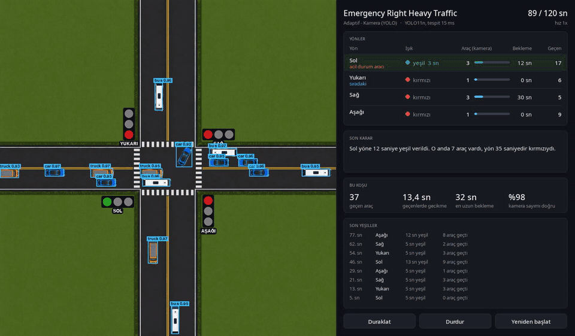
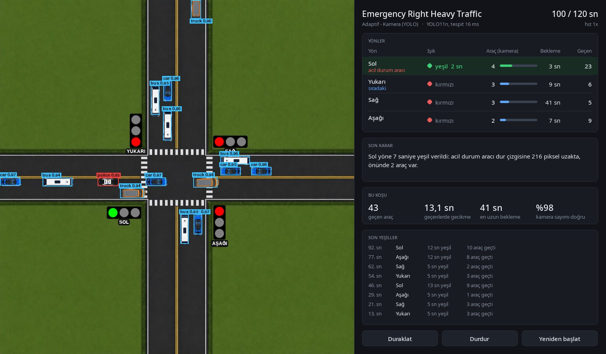

# AI-Powered Smart Intersection

Tek kavşaklı bir trafik ışığı simülasyonu. Işıkları üç farklı yöntemle
yönetip aynı trafik altında karşılaştırıyor:

1. Sabit süreli kontrol: her yön sırayla aynı süre yeşil alır.
2. Adaptif kontrol, tam bilgi: karar kuralı kamera karesindeki araçların
   gerçek sayısını hatasız bilir.
3. Adaptif kontrol, kamera: aynı karar kuralı yalnızca YOLO11n modelinin
   üstten kamera karesinde bulduğu araçlarla çalışır.

İkinci ile üçüncü arasındaki fark, kavşağı kamerayla görmenin kontrole
maliyeti. Birinci ile ikinci arasındaki fark ise kararın kendisinin ne
kazandırdığı.



## Sonuçlar

22 senaryo, senaryo başına 10 tohum, 10 dakikalık koşular. İlk 2 dakika
ısınma olarak ölçüme alınmadı. Sabit süreli kontrol 6, 8, 10, 12, 15 ve 20
saniyelik yeşillerle ayrı ayrı koşuldu ve adaptif kontrol her senaryoda
bunların en iyisiyle karşılaştırıldı. Bekleme süresine, koşu bittiğinde
hâlâ kuyrukta olan araçlar da dahil.

| Trafik türü | Kameralı kontrolün en iyi sabit süreye göre kazancı |
|---|---|
| Tek yönlü, aşırı yönlü | %70-100 |
| Seyrek trafik, boş kavşak | %70-71 |
| Yön ağırlıklı, dönüş çakışmalı | %55-62 |
| Asimetrik yoğun saat | %28 |
| 30 dakikalık karma senaryo | %55 |
| Dengeli trafik türleri | %7-16 |
| Doygun yoğun saat | %1 ile -%8 arası |

22 senaryonun 21'inde kameralı kontrol ortalamada sabit sürenin önünde.
Kazanç, trafiğin yönlere dengesiz dağıldığı ya da seyrek olduğu yerde
büyük: sabit süre boş yöne de yeşil yakmaya devam ediyor. Dengeli trafikte
iyi ayarlanmış bir sabit süreyle fark küçük. Talebin kapasiteyi aştığı
yoğun saatte ise sıralamayı değiştirmek bir şey kazandırmıyor, en uzun
sabit yeşil (15-20 sn) adaptif kontrolle aynı ya da biraz önde.

Acil durum araçları sabit sürede ortalama 18-64 sn bekliyor. Adaptif
kontrolde bu süre senaryoya göre 0,3-23 sn arasında:

| Senaryo | En iyi sabit | Tam bilgi | Kamera |
|---|---:|---:|---:|
| Dengeli trafik | 18,9 sn | 1,6 sn | 1,4 sn |
| Sağ ağırlıklı trafik | 63,6 sn | 15,1 sn | 12,3 sn |
| Doygun yoğun saat | 50,1 sn | 23,0 sn | 19,9 sn |
| Seyrek trafik | 17,9 sn | 0,3 sn | 0,8 sn |
| Karma senaryo | 54,6 sn | 7,4 sn | 8,6 sn |

Kameralı kontrol ile tam bilgili kontrol arasındaki fark senaryo başına -1,0 ile
+1,1 sn arasında, ortancası -0,2 sn. Yani tespit hataları kararları
pratikte değiştirmiyor.

Tablolar: `reports/baseline_sweep/summary.md` ve `reports/camera/summary.md`.

## Kamera tarafı

Kameralı kontrolcü simülasyonun içini okumuyor. Tek girdisi kavşağın
900x900 piksellik üstten görüntüsü.

- Veri kümesi: kareler simülasyondan alınıyor, etiketler araçların
  konumundan otomatik üretiliyor. 1200 eğitim ve 450 doğrulama karesi,
  7 sınıf (otomobil, otobüs, kamyon, motosiklet, ambulans, polis, itfaiye).
  Doğrulama kareleri eğitimde hiç kullanılmamış senaryo ve tohumlardan.
- Model: YOLO11n, 896 piksel girdi, 40 epoch. Doğrulama kümesinde
  mAP50-95 0,98, kesinlik 0,998, duyarlılık 0,999
  (`reports/detector/metrics.json`).
- Gözlem: kare her simülasyon saniyesinde bir kez modele veriliyor. Her
  yaklaşım kolu için görünen araç sayısı, kuyruğun kare kenarına dayanıp
  dayanmadığı ve varsa en yakın acil durum aracı çıkarılıyor.

Tam bilgili kontrolcü de aynı görüş alanını kullanıyor, yalnızca saymayı
hatasız yapıyor. İki kontrolcü arasındaki fark bu yüzden tamamen tespit
hatasından ve bir saniyelik gözlem aralığından geliyor.

### Bu sonuçların söylemediği

Görüntüler simülasyonun kendi çizimi. Araçlar hep aynı ölçekte ve aynı
görünümde, ışık değişimi, hava, gölge ya da örtüşme yok. Model bu yüzden
neredeyse hatasız çalışıyor ve bu doğruluk gerçek bir kamera için bir şey
söylemiyor. Projenin gösterdiği şey veri üretiminden kontrol kararına kadar
uzanan hattın tamamı ve bu hattın ölçülebilir olması. Gerçek görüntüyle
aynı karşılaştırma ayrıca yapılmalı.

Diğer sınırlar:

- Kare dışına taşan kuyruk sayılamıyor. Kural kenara dayanan kuyruğa
  birkaç saniye ek yeşil vererek bunu kabaca telafi ediyor.
- Kare dışında bekleyen acil durum aracı görülmüyor, öncelik araç kareye
  girdiğinde başlıyor.
- Tek kavşak, yaya fazı yok, aynı anda yalnızca bir yön yeşil alıyor.
- Simülasyondaki kapasite (yön başına 1,00 araç/sn) gerçek kavşak
  kayıtlarında ölçülenin (0,45 araç/sn) yaklaşık iki katı. Senaryolar
  kapasiteye oranla tanımlandığı için karşılaştırma geçerli, ama saniye
  cinsinden süreler gerçek bir kavşağa doğrudan taşınamaz. Ayrıntı:
  `docs/scenario_capacity_calibration.md`.

## Karar kuralı

Her yeşilin sonunda kural dört yaklaşım kolunun gözlemine bakıyor:

- Yön: `araç sayısı + 1,5 × (20 sn'yi aşan kırmızı süresi)` en yüksek olan
  yön seçiliyor. Aracı olan her yön bir kez yeşil almadan hiçbir yön ikinci
  kez yeşil almıyor.
- Süre: `2 sn kalkış + araç sayısı / boşalma hızı`, 5 ile 30 sn arasında.
- Acil durum aracı: aracın görüldüğü yön sıradaki yeşili alıyor, süre aracın
  dur çizgisine varış süresine göre hesaplanıyor. Başka bir yön 90 sn'den
  uzun süredir kırmızıysa öncelik verilmiyor.

`tools/verify_decisions.py` her yeşili sonradan olanla karşılaştırıyor.
Son araç geçtikten sonra boşa yanmaya devam eden yeşillerin oranı dengeli
trafikte sabit sürede %24, adaptif kontrolde %17. Az trafikte bu oran %42'den
%25'e iniyor. Adaptif kontrolde yeşillerin en fazla %3'ü kısa kalıyor, yani
o anda sayılan araçların hepsi geçemiyor.

Ayrıntı: `docs/strategy_structure.md`.

## Mimari



```
Arayüz (Tkinter)  →  Kontrolcü  →  Gözlem kaynağı  →  Simülasyon motoru (pygame)  →  Kayıt (JSON)
```

- `ui/`: simülasyon başlatma, senaryo seçimi ve düzenleme, kontrolcü seçimi.
- `controllers/`: sabit süreli kontrolcü ve adaptif kontrolcü. Adaptif
  kontrolcü zamanlamayı yürütüyor, kararı `strategies/demand_strategy.py`
  veriyor.
- `state_providers/`: `ground_truth_provider.py` hatasız sayımı,
  `yolo_provider.py` kamera tespitlerini veriyor.
- `simulation/`: araç üretimi, hareket modeli, sinyal fazları, metrikler ve
  sağdaki karar paneli.
- `core/`, `data/`: senaryolar, kontrolcü tanımları ve koşu sonuçları.

Simülasyon deterministik: senaryo, kontrolcü ve tohum aynıyken sonuç
birebir aynı, işlemci yükü altında da. `tools/verify_determinism.py` bunu
denetliyor.

## Kurulum ve çalıştırma

Python 3.10 veya üstü gerekiyor.

```bash
pip install -r requirements.txt          # pygame, matplotlib
pip install -r requirements-yolo.txt     # kameralı kontrol için: ultralytics

python main.py
```

Sonuç tablolarını yeniden üretmek için:

```bash
python tools/baseline_sweep.py
python tools/baseline_sweep_report.py

python tools/baseline_sweep.py --greens --adaptive adaptive_camera \
    --output reports/camera/raw_results.csv
python tools/camera_comparison_report.py
```

Eğitilmiş model `weights/vehicle_detector.pt` olarak repoda. Modeli baştan
üretmek için:

```bash
python tools/generate_detection_dataset.py
python tools/train_detector.py
```

Doğrulama betikleri:

```bash
python tools/verify_determinism.py     # aynı tohum, aynı sonuç
python tools/verify_vehicle_motion.py  # hareket modeli kuralları
python tools/verify_decisions.py       # yeşillerin sonradan denetimi
```

## Belgeler

`docs/` altında, Türkçe:

- `01_project_overview.md`: amaç, mimari, deney düzeni.
- `engine_overview.md`: simülasyon motoru, hareket modeli, determinizm.
- `strategy_structure.md`: karar kuralı ve parametreleri.
- `metrics_definitions.md`: metrik tanımları.
- `scenario_capacity_calibration.md`: kapasite, senaryo yoğunlukları,
  gerçek kayıtlarla ilişki.
- `results_and_limits.md`: tam sonuç tabloları ve modelin kapsamadığı
  şeyler.
