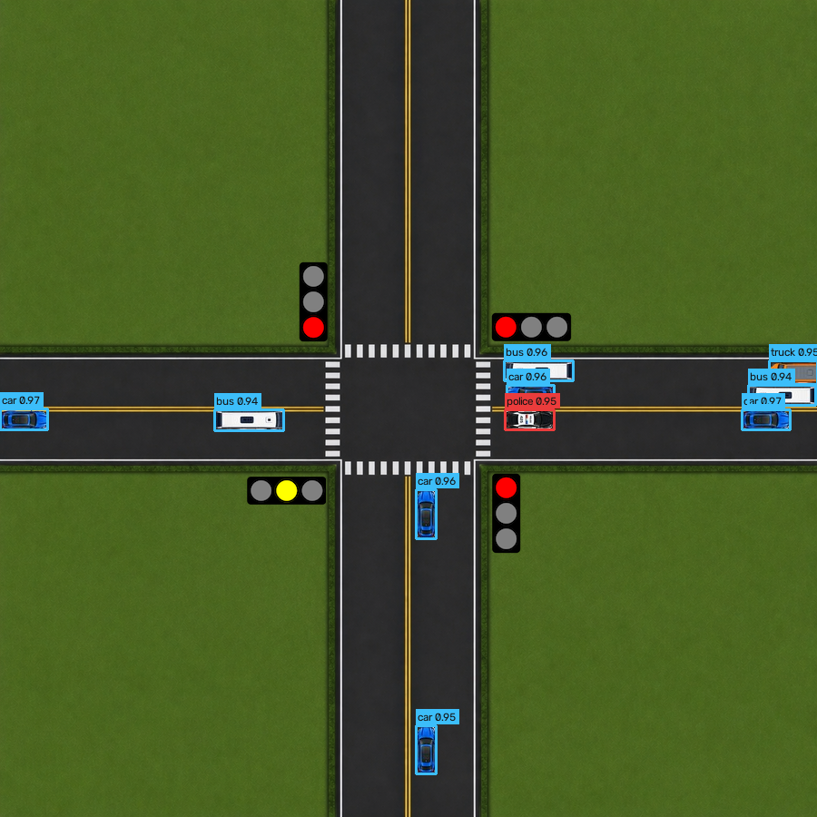

# Akıllı Kavşak — Kamera Tespitiyle Adaptif Trafik Işığı Kontrolü

Tek kavşaklı bir trafik ışığı simülasyonu (Tkinter + pygame). Üç kontrol
biçimini aynı senaryolarda karşılaştırıyor: sabit süreli kontrol, kavşaktaki
her aracı bilen adaptif kontrol ve yalnızca kamera karesindeki YOLO
tespitlerini kullanan adaptif kontrol.


## Proje üç aşamalı bir yol haritası izliyor

1. **Sabit süreli kontrolü modellemek** — tamamlandı, referans/karşılaştırma noktası.
2. **Adaptif algoritma geliştirmek ve doğrulamak** — tamamlandı. Kuyruk teorisine
   dayanan bir strateji ailesi (`optimal_ground_truth` v1/v2/v3,
   `rolling_horizon_ground_truth`), 22 senaryoda sabit süreli kontrolle
   karşılaştırıldı. Sonuçlar aşağıda.
3. **Kamera tespitiyle kontrol (YOLO)** — tamamlandı. Simülasyon karelerinden
   veri kümesi üretildi, YOLO11n eğitildi ve kontrolcü yalnızca modelin
   tespitleriyle çalıştırıldı. Sonuçlar aşağıda.

## Sonuçlar

22 senaryo, senaryo başına 10 seed, 10 dakikalık koşular (ilk 2 dakika ısınma).
Sabit süre 5 farklı yeşil süresiyle tarandı ve adaptif kontrolcü her senaryonun
**en iyi** sabit süresiyle karşılaştırıldı. Bekleme süresi, koşu sonunda hâlâ
kuyrukta olan araçları da içerir.

| Trafik türü | En iyi sabit süreye göre bekleme kazancı |
|---|---|
| Tek yönlü, aşırı yönlü | %94-100 |
| Seyrek trafik, boş kavşak | %70-76 |
| Yön ağırlıklı, asimetrik, dönüş çakışmalı | %42-56 |
| 30 dakikalık karma senaryo | %44 |
| Dengeli trafik türleri | %1-11 |
| Doygun yoğun saat | -%8 (sabit süre önde) |

- Adaptif kontrol 22 senaryonun 20'sinde ortalamada önde, 16'sında koşuların en az %80'inde önde.
- Kazanç trafiğin yönlere dengesiz dağıldığı durumlardan geliyor. Dengeli trafikte iyi ayarlanmış sabit süreyle fark küçük, kapasitenin aşıldığı yoğun saatte adaptif geride.
- Acil durum araçları sabit sürede 13-45 sn, öncelikli adaptif kontrolde çoğu senaryoda 4 sn'nin altında bekliyor.

Tam tablo, yöntem ve sınırlar: `docs/ground_truth_final_state_and_gaps.md` Bölüm 2.
Ham veri: `reports/baseline_sweep/`.

## Kamera tespitiyle kontrol



Bu aşamada kontrolcü simülasyonun içini okumaz. Elindeki tek girdi kavşağın
900x900 piksellik üstten karesi ve o karede modelin bulduğu kutulardır.

- **Veri kümesi:** kareler simülasyondan alınır, etiketler araç konumlarından
  otomatik üretilir. 1200 eğitim, 450 doğrulama karesi, 7 sınıf (otomobil,
  otobüs, kamyon, motosiklet, ambulans, polis, itfaiye). Doğrulama kareleri
  eğitimde kullanılmayan senaryo ve tohumlardan gelir.
- **Model:** YOLO11n, 896 piksel girdi, 40 epoch. Doğrulama kümesinde
  mAP50-95 0,98.
- **Kuyruk ölçümü:** kare simülasyon saniyesinde bir kez modele verilir. Bir
  yaklaşım kolunda, önceki gözlemden bu yana yer değiştirmemiş araçlar kuyruk
  sayılır.
- **Karar kuralı:** tam bilgili v3 ile aynı. Böylece iki kontrolcü arasındaki
  fark algılamanın maliyetini verir.

Aynı 22 senaryo ve aynı tohumlarla:

| | Kameralı kontrol |
|---|---|
| En iyi sabit süreye göre bekleme kazancı | ortanca %26, ortalama %32 |
| Ortalamada sabit sürenin önünde olduğu senaryo | 22'de 20 |
| Tam bilgili v3'e göre ek bekleme | ortanca 1,2 sn, en yüksek 5,6 sn |

| Acil durum aracının ortalama beklemesi | En iyi sabit | Tam bilgi (v3) | Kamera |
|---|---:|---:|---:|
| Seyrek trafik | 12,7 sn | 0,6 sn | 1,3 sn |
| Dengeli trafik | 27,7 sn | 3,4 sn | 9,0 sn |
| Sağ ağırlıklı trafik | 46,7 sn | 3,0 sn | 11,1 sn |
| Doygun yoğun saat | 43,9 sn | 9,6 sn | 35,0 sn |

Ne anlama geliyor:

- Kuyruğun kareye sığdığı senaryolarda kameralı kontrol tam bilgili kontrolle
  aynı sonucu veriyor.
- Kayıp, kuyruğun karenin dışına taştığı senaryolarda büyüyor. Kamera karede
  görünenden uzun kuyruğu sayamıyor.
- Acil durum önceliği kare içinde çalışıyor. Araç uzun bir kuyruğun arkasında
  kare dışında beklerken kontrolcü onu göremiyor, doygun yoğun saatte bekleme
  sabit süreye yaklaşıyor.
- Doygun yoğun saatte kameralı kontrol v3'ten 2-3 sn daha iyi. Bu bir üstünlük
  değil: kuyruk sayısı karede görünenle sınırlı kaldığı için yönlere daha eşit
  süre veriliyor ve bu tıkanmış kavşakta işe yarıyor.

Sınır: görüntüler simülasyonun kendi üstten çizimidir. Araçlar hep aynı
ölçekte ve aynı görünümdedir, ışık, hava ve örtüşme yoktur. Bu yüzden tespit
kolaydır ve buradaki doğruluk gerçek kamera görüntüsü için bir şey söylemez.
Çalışmanın gösterdiği şey veri kümesinden kontrol kararına uzanan hattın
tamamı ve sınırlı görüş alanının kontrol kalitesine maliyetidir.

Tam tablo: `reports/camera/summary.md`. Model ölçümleri:
`reports/detector/metrics.json`.

## Mimari

```
UI (Tkinter, 3 sekme)  →  Controller (fixed / adaptive)  →  State Provider  →  Simulation Engine  →  Persistence (JSON)
```

- **UI** (`ui/`): `Home` (simülasyon başlatma), `Scenarios` (senaryo seçimi
  + JSON ile yeni senaryo oluşturma), `Providers` (kontrolcü/strateji seçimi).
- **Controller** (`controllers/`): `fixed_time_controller.py` ya da
  `adaptive_controller.py` (ortak faz mekaniğini kendisi yönetir, karar
  mantığını `controllers/strategies/`'e delege eder).
- **State Provider** (`state_providers/`): controller'ın trafik durumunu
  *nasıl gördüğünü* belirler — `ground_truth` (tam bilgi, tüm araçları
  hatasız görür) ya da `yolo` (kamera karesindeki YOLO tespitleri, kare
  dışını görmez).
- **Simulation Engine** (`simulation/engine.py`): araç doğuşu, hareket,
  sinyal fazları, metrik toplama, render veya headless çalışma. İki thread
  + tek otoriter saat modeliyle **deterministik** çalışır — aynı
  (senaryo, kontrolcü, seed) her zaman birebir aynı sonucu üretir.
- **Persistence** (`core/`, `data/*.json`): senaryolar, kontrolcü
  versiyonları, provider'lar ve deney sonuçları JSON registry'ler
  üzerinden saklanır.

## Kurulum ve çalıştırma

Gerekenler: Python 3.10+, `pygame`, `matplotlib`. Kameralı kontrol için ek
olarak `requirements-yolo.txt` (Ultralytics, PyTorch).

```bash
pip install -r requirements.txt

# GUI uygulamasını başlat
python main.py

# Tüm senaryo × kontrolcü × seed matrisini headless çalıştır (120 sn'lik kısa koşular)
python tools/run_batch_tests.py

# Sabit süre taraması ve adaptif karşılaştırma (yukarıdaki sonuçları üretir)
python tools/baseline_sweep.py
python tools/baseline_sweep_report.py

# Determinizm garantisini doğrula
python tools/verify_determinism.py

# En son batch'ten markdown + PNG rapor üret
python tools/report_generator.py
```

Kameralı kontrol. Eğitilmiş ağırlık `weights/vehicle_detector.pt` olarak
repoda, ilk iki adım yalnızca modeli yeniden üretmek için gerekir:

```bash
pip install -r requirements-yolo.txt

# Simülasyondan etiketli kare üret, modeli eğit
python tools/generate_detection_dataset.py
python tools/train_detector.py

# Kameralı kontrolcüyü 22 senaryoda koştur, üçlü karşılaştırmayı üret
python tools/baseline_sweep.py --greens --adaptive adaptive_camera_queue_v1 --output reports/camera/raw_results.csv
python tools/camera_comparison_report.py
```

## Mevcut durum

| Katman | Durum |
|---|---|
| Fixed-time controller | Sağlam, referans noktası |
| `ground_truth` provider + strateji ailesi | Çalışıyor, sonuçları ve sınırları yukarıda. Önerilen: `adaptive_optimal_ground_truth_v3` (tek-adım), `adaptive_rolling_horizon_ground_truth` (çok-adım) |
| `yolo` provider + `adaptive_camera_queue_v1` | Çalışıyor. Yalnızca 900x900 kareyi görür, sonuçları ve sınırları yukarıda |

## Dokümantasyon

Detaylı (Türkçe) dokümantasyon `docs/` altında — özellikle:

- `docs/01_project_overview.md` — proje amacı, yol haritası, genel mimari (başlangıç noktası).
- `docs/engine_overview.md` — simülasyon motorunun iç işleyişi, determinizm.
- `docs/strategy_structure.md` — adaptif strateji sözleşmesi, yeni strateji ekleme.
- `docs/metrics_definitions.md` — her metriğin tanımı ve bilinen metodolojik notlar.
- `docs/scenario_capacity_calibration.md` — senaryo talep kalibrasyonu (güncel referans).
- `docs/ground_truth_final_state_and_gaps.md` — tam bilgili kontrolün sonuç tablosu, sistemin gerçek trafikte karşıladığı/kapsamadığı şeyler.

## Determinizm

`(senaryo, kontrolcü modu, kontrolcü versiyonu, state provider, seed)`
beşlisi sabitken simülasyon birebir deterministiktir. Motor/kontrolcü/
strateji tarafında yapılan herhangi bir değişiklikten sonra
`python tools/verify_determinism.py` çalıştırılmalı.
