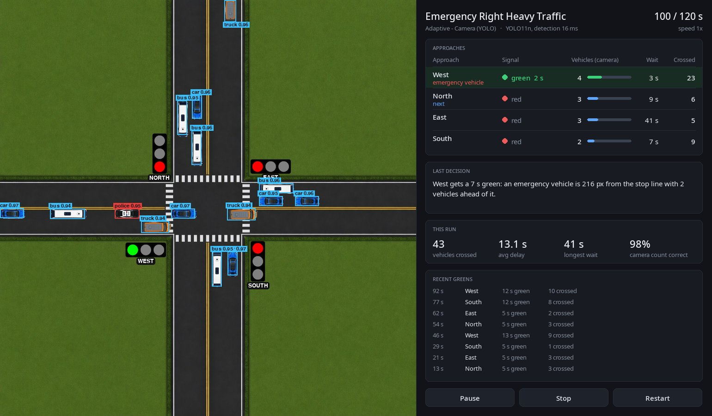

# AI-Powered Smart Intersection

[English](README.md)

Tek kavşaklı bir trafik ışığı simülasyonu. Işıkları üç farklı yöntemle yönetip aynı trafik altında karşılaştırıyor:

1. Sabit süreli kontrol: her yön sırayla aynı süre yeşil alıyor.
2. Adaptif kontrol, ground truth: karar kuralı kamera frame'indeki araç sayısını hatasız biliyor.
3. Adaptif kontrol, kamera: aynı karar kuralı yalnızca YOLO11n modelinin üstten kamera görüntüsünde bulduğu araçlarla çalışıyor.

2 ile 3 arasındaki fark, kavşağı kamerayla görmenin maliyeti. 1 ile 2 arasındaki fark da karar kuralının kendisinin ne kazandırdığı.


## Sonuçlar

22 senaryo, her biri 10 farklı seed'le, 10 dakikalık koşular. İlk 2 dakika warmup olarak ölçüme katılmadı. Sabit süreli kontrol 6, 8, 10, 12, 15 ve 20 saniyelik yeşillerle ayrı ayrı koşuldu, adaptif kontrol her senaryoda bunların en iyisiyle karşılaştırıldı. Bekleme süresine koşu sonunda hâlâ kuyrukta olan araçlar da dahil.

| Trafik | Kameralı kontrol, en iyi sabit süreye göre |
|---|---|
| Tek yönlü, aşırı yönlü | %70-100 daha az bekleme |
| Seyrek, boş kavşak | %70-71 daha az bekleme |
| Yön ağırlıklı, dönüş çakışmalı | %55-62 daha az bekleme |
| Asimetrik yoğun saat | %28 daha az bekleme |
| 30 dakikalık karma senaryo | %55 daha az bekleme |
| Dengeli trafik | %7-16 daha az bekleme |
| Doygun yoğun saat | %1 daha az ile %8 daha fazla arası |

Kameralı kontrol 22 senaryonun 21'inde ortalamada sabit süreden iyi. Asıl kazanç trafiğin dengesiz ya da seyrek olduğu durumlarda, çünkü sabit süre boş yöne de yeşil yakmaya devam ediyor. Dengeli trafikte iyi ayarlanmış bir sabit süre çok geride kalmıyor. Talep kapasiteyi aştığında ise yeşillerin sırasını değiştirmek işe yaramıyor, en uzun sabit yeşiller (15-20 sn) adaptifle başa baş ya da biraz önde.

Acil durum araçları sabit sürede ortalama 18-64 sn bekliyor. Adaptif kontrolde bu süre senaryoya göre 0,3 ile 23 sn arasında:

| Senaryo | En iyi sabit | Ground truth | Kamera |
|---|---:|---:|---:|
| Dengeli trafik | 18,9 sn | 1,6 sn | 1,4 sn |
| Sağ ağırlıklı trafik | 63,6 sn | 15,1 sn | 12,3 sn |
| Doygun yoğun saat | 50,1 sn | 23,0 sn | 19,9 sn |
| Seyrek trafik | 17,9 sn | 0,3 sn | 0,8 sn |
| Karma senaryo | 54,6 sn | 7,4 sn | 8,6 sn |

Kameralı kontrol ile ground truth arasındaki fark senaryo başına -1,0 ile +1,1 sn arasında, medyanı -0,2 sn. Yani tespit hataları kararları neredeyse hiç değiştirmiyor.

Tam tablolar: `reports/baseline_sweep/summary.md` ve `reports/camera/summary.md`.

## Kamera tarafı

Kameralı kontrolcü simülasyonun içini hiç okumuyor, tek girdisi kavşağın 900x900'lük üstten görüntüsü.

- Dataset: frame'ler simülasyondan alınıyor, etiketler araçların konumundan otomatik üretiliyor. 1200 train, 450 validation frame'i, 7 sınıf (otomobil, otobüs, kamyon, motosiklet, ambulans, polis, itfaiye). Validation frame'leri train'de hiç kullanılmamış senaryo ve seed'lerden geliyor.
- Model: YOLO11n, 896 piksel input, 40 epoch. Validation set'inde mAP50-95 0,98, precision 0,998, recall 0,999 (`reports/detector/metrics.json`).
- Gözlem: frame her simülasyon saniyesinde bir kez modelden geçiyor. Her yön için görünen araç sayısı, kuyruğun frame kenarına dayanıp dayanmadığı ve varsa en yakın acil durum aracı çıkarılıyor.

Ground truth kontrolcüsü de aynı görüş alanını kullanıyor, sadece hatasız sayıyor. Dolayısıyla ikisi arasındaki fark tamamen tespit hatalarından ve bir saniyelik gözlem aralığından geliyor.

### Bu sonuçların söylemediği

Görüntüler simülasyonun kendi çizimi. Araçlar hep aynı boyutta ve aynı görünümde; ışık değişimi, hava, gölge ya da occlusion yok. Model bu yüzden neredeyse hatasız çalışıyor ve bu doğruluk gerçek bir kamera hakkında bir şey söylemiyor. Projenin gösterdiği şey, veri üretiminden sinyal kararına kadar uzanan pipeline'ın tamamı ve bunun ölçülebilir olması. Aynı karşılaştırmanın gerçek görüntüyle de yapılması gerekiyor.

Diğer sınırlar:

- Frame dışına taşan kuyruk sayılamıyor. Kural, kenara dayanan kuyruğa birkaç saniye ek yeşil vererek bunu kabaca telafi ediyor.
- Frame dışında bekleyen acil durum aracı görülmüyor, öncelik araç frame'e girince başlıyor.
- Tek kavşak var, yaya fazı yok, aynı anda yalnızca bir yön yeşil yanıyor.
- Simülasyondaki kapasite (yön başına 1,00 araç/sn) gerçek kavşak kayıtlarında ölçülenin (0,45 araç/sn) yaklaşık iki katı. Senaryolar kapasiteye oranla tanımlandığı için karşılaştırma geçerli, ama saniye cinsinden süreler gerçek bir kavşağa birebir taşınamaz. Detaylar: `docs/scenario_capacity_calibration.md`.

## Karar kuralı

Her yeşil bittiğinde kural dört yönün gözlemine bakıyor:

- Yön: `araç sayısı + 1,5 × (20 sn'yi aşan kırmızı süresi)` en yüksek olan yön yeşili alıyor. Aracı olan her yön bir kez yeşil almadan hiçbir yön ikinci kez almıyor.
- Süre: `2 sn kalkış + araç sayısı / boşalma hızı`, 5 ile 30 sn arasında.
- Acil durum aracı: aracın görüldüğü yön sıradaki yeşili alıyor, süre aracın dur çizgisine varışına göre hesaplanıyor. Başka bir yön 90 sn'den uzun süredir kırmızıdaysa öncelik verilmiyor.

`tools/verify_decisions.py` her yeşili sonrasında olanlarla karşılaştırıyor. Dengeli trafikte, son araç geçtikten sonra boşa yanmaya devam eden yeşillerin oranı sabit sürede %24, adaptifte %17. Az trafikte bu oran %42'den %25'e düşüyor. Adaptif yeşillerin en fazla %3'ü kısa kalıyor, yani o an sayılan araçların hepsi geçemiyor.

Detaylar: `docs/strategy_structure.md`.

## Mimari



```
UI (Tkinter)  →  Controller  →  State provider  →  Simulation engine (pygame)  →  Storage (JSON)
```

- `ui/`: simülasyonu başlatma, senaryo seçme ve düzenleme, kontrolcü seçme. Türkçe ve İngilizce.
- `controllers/`: sabit süreli ve adaptif kontrolcü. Adaptif kontrolcü zamanlamayı yönetiyor, kararı `strategies/demand_strategy.py` veriyor.
- `state_providers/`: `ground_truth_provider.py` hatasız sayımı, `yolo_provider.py` kamera tespitlerini veriyor.
- `simulation/`: araç üretimi, hareket modeli, sinyal fazları, metrikler ve sağdaki karar paneli.
- `core/`, `data/`: senaryolar, kontrolcü tanımları ve koşu sonuçları.

Simülasyon deterministik: senaryo, kontrolcü ve seed aynıysa sonuç da birebir aynı, CPU yükü altında bile. `tools/verify_determinism.py` bunu kontrol ediyor.

## Kurulum

Python 3.10 veya üstü gerekiyor.

```bash
pip install -r requirements.txt          # pygame, matplotlib
pip install -r requirements-yolo.txt     # kameralı kontrol için: ultralytics

python main.py
```

Arayüz varsayılan olarak İngilizce açılıyor, dil sağ üstteki menüden değiştirilebiliyor.

Sonuç tablolarını yeniden üretmek için:

```bash
python tools/baseline_sweep.py
python tools/baseline_sweep_report.py

python tools/baseline_sweep.py --greens --adaptive adaptive_camera \
    --output reports/camera/raw_results.csv
python tools/camera_comparison_report.py
```

Eğitilmiş model repoda `weights/vehicle_detector.pt` olarak duruyor. Sıfırdan üretmek için:

```bash
python tools/generate_detection_dataset.py
python tools/train_detector.py
```

Kontrol betikleri:

```bash
python tools/verify_determinism.py     # aynı seed, aynı sonuç
python tools/verify_vehicle_motion.py  # hareket modeli kuralları
python tools/verify_decisions.py       # her yeşilin sonradan denetimi
```

## Dokümantasyon

`docs/` altındaki belgeler İngilizce:

- `01_project_overview.md`: amaç, mimari, deney düzeni.
- `engine_overview.md`: simülasyon motoru, hareket modeli, determinizm.
- `strategy_structure.md`: karar kuralı ve parametreleri.
- `metrics_definitions.md`: metrik tanımları.
- `scenario_capacity_calibration.md`: kapasite, senaryo yoğunlukları, gerçek kayıtlarla karşılaştırma.
- `results_and_limits.md`: tam sonuç tabloları ve modelin kapsamadığı şeyler.

## Lisans

MIT, bkz. [LICENSE](LICENSE). `assets/fonts/` altındaki Noto Sans fontları SIL Open Font License ile dağıtılıyor (`assets/fonts/OFL.txt`).
